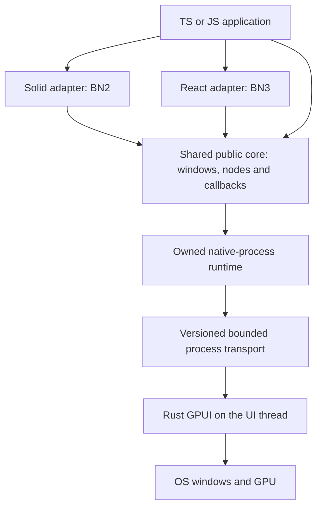

# Bun Native architecture

**Status:** BN0's real Bun-controlled GPUI window and inspected machine-code AOT path are merged. BN1 implements a shared native element tree, versioned atomic mutations and an opaque public TS/JS API in the current source. Actual Linux X11 development/AOT runs have exercised pointer input, typing, Enter activation, stale-input rejection, native paint and cleanup using Mesa's software GPU. Framework adapters and a supported cross-platform release matrix remain later work. See [the BN0 record](bn0-integration.md), [native protocol 2](native-abi.md) and [the public API](../packages/core/README.md) for the precise boundary.

## System layers

**Rust GPUI is the initial rendering engine.** Switching to another native rendering engine is allowed if technically justified and documented, but a WebView/CEF/Chromium UI is not an accepted fallback.

### Development and release modes

- **Development:** ordinary Bun executes application TS/JS against an explicitly selected prebuilt host. Watchers and framework reload are BN5 work; they are not implemented by launching the current example.
- **Production:** Bun's experimental `bun compile` checks/compiles supported program logic to machine code on the target host. A reduced Bun runtime, event loop and GC may still ship; no JIT is claimed only after inspecting the real AOT artifact.
- **Native host:** GPUI or another approved native renderer is compiled by framework maintainers and distributed as versioned host artifacts. A consumer editing a TSX component must not silently invoke Cargo.

AOT is an execution mechanism, **not** a JSX/CSS-to-Rust compiler. The Solid/React adapters must translate framework tree operations into the native host's supported elements.

## Implemented foundation

| Source                   | Responsibility                                                                      | Dependency direction                          |
| ------------------------ | ----------------------------------------------------------------------------------- | --------------------------------------------- |
| `packages/protocol`      | Portable framing and validated command/event contracts                              | No runtime or renderer dependencies           |
| `packages/runtime`       | Own one prebuilt native process, handshake, requests, events and shutdown           | Protocol public exports and Bun platform APIs |
| `packages/core`          | Opaque handles, atomic batches, input revisions and owned application callbacks     | Protocol and runtime public exports           |
| `native/protocol`        | Rust validation and framing matching the TypeScript contract                        | Serde and standard library                    |
| `native/gpui-host`       | Main-thread GPUI window, widgets and native input                                   | Rust protocol and pinned GPUI                 |
| `examples/native-window` | Bun-owned counter state and native event observation                                | Core public exports                           |
| `experiments/aot-gpui`   | Compiler interoperability, negative controls, binary inspection and artifact recipe | Pinned compiler and explicit prebuilt host    |

`scripts/quality/boundaries.ts` checks TypeScript import direction and runtime dependency use. Both Rust crates share the root Cargo workspace and lock. The example never invokes Cargo. Its `BUN_NATIVE_HOST` setting selects an already-built executable; the AOT recipe copies that same host into the output and records its hash.

Protocol 2 replaces the one-window BN0 fixture. Its `hello`, `open`, `batch`, `close` and `shutdown` commands operate on a bounded multi-window tree of boxes, text, buttons and editable inputs. The native input owns editing state; explicit application replacements require its current edit revision. Atomic tree batches carry a separate base revision. The [ABI contract](native-abi.md) defines ownership, identity, limits, reply validation, thread authority and failure semantics.

## Planned package boundaries

| Area                      | Responsibility                                                   | May depend on                                  |
| ------------------------- | ---------------------------------------------------------------- | ---------------------------------------------- |
| Public core API           | Typed windows, elements, events, errors, capabilities, lifecycle | Portable contracts and private process runtime |
| Native host and bridge    | ABI, event queue, resource ownership, renderer integration       | Core contract and native OS libraries          |
| Solid adapter             | Solid signals/owner lifecycle mapped to native host              | Public core, Solid                             |
| React adapter             | React reconciler mapped to native host                           | Public core, React                             |
| Shared components         | Layout, text, input, overlays, style tokens, accessibility       | Public native host primitives                  |
| CLI/tooling               | Create/dev/build/diagnose, AOT, package resolution, reload       | Public contracts, compiler/native artifacts    |
| Platform artifacts        | Per-OS/arch native host and manifest                             | Pinned native build                            |
| Examples/tests/benchmarks | Consumer behavior and evidence                                   | Only public APIs wherever possible             |

Enforce this dependency direction, without introducing layers that merely forward arguments. Public UI packages should not import Rust internals or require browser globals. Avoid duplicate native widget implementations across Solid/React.

## Native bridge and host lifecycle

BN0 selects an owned subprocess with bounded, validated JSON-lines messages. This gives GPUI the process main thread and keeps application logic in ordinary Bun or the same source's AOT executable. The executed FFI probe demonstrates synchronous native calls and callbacks, but does not establish GPUI thread integration or asynchronous callback safety. [ADR 0002](decisions/0002-owned-native-process.md) records the selection and its cost. BN1 extends that transport into reusable handles, tree mutations, batching and capabilities. [Bridge measurements](../benchmarks/BRIDGE.md) retain individual/batched acknowledgements and their limits; no latency advantage is assumed.

The implemented host contract specifies:

1. Window and element identities, typed kinds and immutable ownership scope.
2. Create/update/reorder/delete tree mutations; diffing and batching to minimize crossings.
3. UI-thread mutation authority; bounded queues, callback dispatch, event ordering and backpressure.
4. Resource and callback disposal, shutdown, startup rollback and stale-handle rejection.
5. Version/ABI negotiation and explicit unsupported-platform errors.
6. Security: rejection of malformed messages and unsupported services, with a default-deny policy required before adding file/process/clipboard/network bindings.

Opaque IDs alone are not authorization. Use runtime validation at trust and native boundaries even when TypeScript types are precise.

## Framework renderers

**SolidJS (BN2):** investigate `solid-js/universal`; implement a native custom renderer for signals, effects, keyed lists, mount/update/unmount and mapped input. No assumption that `solid-js/web` or DOM-oriented components work without adaptation.

**React (BN3):** implement a pinned `react-reconciler` host configuration over the **same** native tree. Validate refs, hooks/effects, scheduling, errors, input and cleanup. Do not use React DOM or duplicate the Rust widget implementation.

**Shared native UI (BN4):** provide text/layout/input/buttons/menus/dialogs/scrollers/virtualized lists, theme tokens and OS services. Minimal primitives begin as soon as the BN1 host is stable, in parallel with renderer adapters; advanced text/IME/accessibility and widgets may complete later.

## Native desktop services and security

Use explicit, scoped capabilities for clipboard, files, PTY/processes, notifications, shortcuts, dialogs and other OS integrations. Native handles must have owners, lifetime and revocation behavior. Browserless rendering does not itself sandbox app logic or untrusted data. The [BN1 threat model #252](https://github.com/0xPlayerOne/bun-native/issues/252) and [BN4 platform APIs #255](https://github.com/0xPlayerOne/bun-native/issues/255) own the actual contracts.

## Hot reload, platform targets and packaging

BN5 owns the edit loop: watch TS/JS source, update/recreate the component tree safely, preserve state only where supported, dispose old callbacks, restart only on native ABI/config changes. No Rust recompilation for normal app edits.

BN6 owns macOS/Windows/Linux host-native AOT builds and verified artifacts. Each OS/CPU target needs its own support evidence, resources, launcher and ABI manifest. Signing, installers, updates and rollback are distinct from merely compiling an executable.

## Quality, performance and observability

Follow [engineering-quality.md](engineering-quality.md). The highest-risk paths are native crossing count/batching, event queue growth, UI-thread stalls, text layout/IME, scrolling/virtualization, repeated reload/disposal, memory retention and AOT compiler slow paths. Record the same workload on actual supported hardware with source version, Bun/renderer pins, startup, RSS, frame/input latency, artifact bytes and raw samples. No performance advantage is assumed.

## Current gaps

The public element API and protocol 2 are experimental and implemented; they are not a compatibility promise. Solid/React adapters, general native services, complete text accessibility, hot reload and distributable cross-platform releases do not yet exist. Linux software-GPU evidence does not qualify macOS/Windows GUI behavior, Wayland, physical GPUs, IME or assistive technology. BN1's native release-host/retention audit remains an explicit checkpoint; BN4 and BN6 own the corresponding usability and platform acceptance.

See [decision records](decisions/README.md), [toolchain](toolchain.md), [testing](testing.md) and the [master roadmap](https://github.com/0xPlayerOne/bun-native/issues/1).
