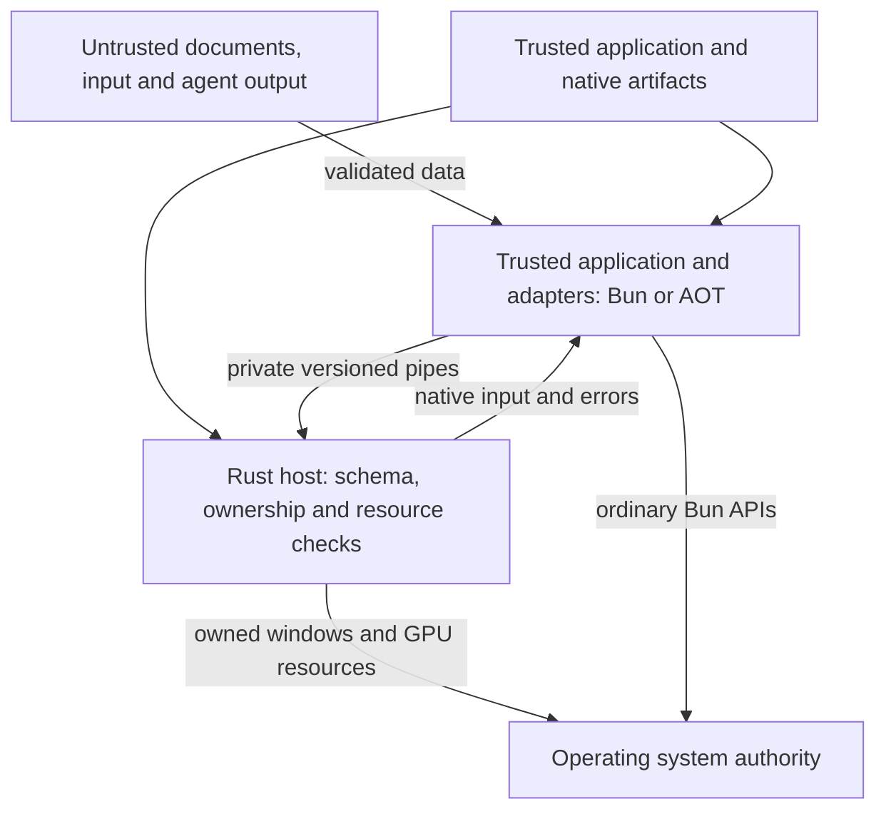

# ADR 0003 — Trust, authority and lifetime at the native boundary

Status: accepted policy for BN1; verification scope is recorded below

Date: October 31, 2026

Related: [#252](https://github.com/0xPlayerOne/bun-native/issues/252), [#228](https://github.com/0xPlayerOne/bun-native/issues/228), [#229](https://github.com/0xPlayerOne/bun-native/issues/229), [#232](https://github.com/0xPlayerOne/bun-native/issues/232), [#255](https://github.com/0xPlayerOne/bun-native/issues/255), [#247](https://github.com/0xPlayerOne/bun-native/issues/247), [#245](https://github.com/0xPlayerOne/bun-native/issues/245)

## Context and decision

The application, its dependencies and renderer adapters are trusted executable code. Files, network responses, clipboard contents, user-entered text, model output and agent-generated instructions are untrusted data until the application validates their intended use. Displaying a command in a native text element does not authorize executing it. A model's request for a capability is not a grant.

Keep the owned GPUI subprocess selected in [ADR 0002](0002-owned-native-process.md). Its private pipes establish session ownership and a native crash boundary. Neither process is an operating-system sandbox: both normally run with the application's user account and environment. Trusted Bun code can use Bun's own filesystem, process and network APIs independently of this bridge. The native capability policy therefore constrains operations exposed through the host; it cannot confine malicious application code or a compromised native executable.

The diagram deliberately includes the direct Bun-to-OS route. A subprocess, Rust types, browserless rendering and AOT do not remove that authority. The [inspected AOT artifact](../aot-inspection.md) omits the JIT but retains an interpreter; AOT is not an authorization mechanism or proof that evaluating untrusted strings is safe.

## Entry points and hostile input

The runtime validates both authored JavaScript values and received native events. Rust independently validates every command after bounded UTF-8 framing, before a command reaches GPUI. Unknown command, element, style and message fields are rejected. Malformed native input poisons that channel; it is not resynchronized into a potentially different operation. Protocol version and required rendering features must agree before any public operation succeeds. The peer's claimed version is compatibility information, not proof of artifact authenticity.

Only the typed `box`, `text`, `button` and `input` elements are part of the initial tree contract. Text remains literal data. There is no HTML renderer, script element, `on_click` source string, CSS URL loader, browser navigation endpoint or implicit WebView capability. A future rich-content renderer must define a separate parsing and resource policy before accepting HTML or active content. No current claim covers safe execution of arbitrary web content.

Window and node IDs are positive JavaScript-safe integers scoped to one owned host session. The native model resolves a node only in its owning window. Committed IDs increase across the session and cannot be reused after deletion or close. An ID is a reference, not an OS permission token. A new session revokes all references to the old process. Application data must never choose internal handles or turn a displayed identifier into authority.

The native UI thread is the sole mutation owner. A batch is prepared against the specified tree revision and committed only after its shape, ownership, resource and graph checks succeed. A rejected batch must leave the tree, allocation high-water mark and revisions unchanged. Native input has its own revision so a delayed application snapshot cannot overwrite newer typing. Disposing a subtree revokes every descendant; callbacks and pending work must not retain authority over a disposed object.

## Native service policy

The negotiated `tree` and `input_revisions` flags describe implemented rendering features. They are not grants to read files, run programs or access other OS services. Protocol 2 exposes no general service invocation or capability-grant command. The shared negative corpus verifies that attempts to self-grant privileges or invoke the following unsupported bindings are rejected by both language implementations.

| Capability or binding        | Current boundary and negative case                                                                                                    | Required follow-up before exposure                                                                                                                         |
| ---------------------------- | ------------------------------------------------------------------------------------------------------------------------------------- | ---------------------------------------------------------------------------------------------------------------------------------------------------------- |
| Filesystem read/write        | `filesystem-read`, `filesystem-write` rejected                                                                                        | [#255](https://github.com/0xPlayerOne/bun-native/issues/255): scoped file/directory handles, traversal and symlink policy, revocation, denied access tests |
| Process/PTY and shell        | `process-launch`, `shell-execution` rejected                                                                                          | #255: explicit executable/argument policy, no command-string interpolation, owned process cleanup and cancellation                                         |
| Network requests             | `network-request` rejected by the native bridge                                                                                       | #255: destination policy and redirect handling if a native service is introduced; ordinary trusted Bun networking remains outside this broker              |
| Clipboard read/write         | Programmatic bindings rejected by `clipboard-read` and `clipboard-write`                                                              | #255: explicit app policy and data limits; native editing shortcuts are a separate user interaction, not an ambient RPC grant                              |
| External URL opening         | `external-url` rejected                                                                                                               | #255: allowlisted schemes and native user-activation/permission policy; rendered text must not launch a URL automatically                                  |
| Native plugins               | `native-plugin` rejected                                                                                                              | [#247](https://github.com/0xPlayerOne/bun-native/issues/247): artifact provenance, ABI and authority model before accepting third-party native code        |
| Updates                      | `install-update` rejected                                                                                                             | #247: authenticated artifact metadata, target/version checks, integrity, interrupted-update recovery and rollback policy                                   |
| Browser/script/HTML bindings | `embedded-browser`, `code-evaluation`, `script-element`, `browser-element`, `raw-html-property`, `executable-click-property` rejected | No browser fallback. Any future passive rich-text feature needs its own data-only contract under #255/#247                                                 |

Before adding a sensitive service, the native side must enforce a default-deny grant associated with the session, owner, operation and resource scope. Untrusted data cannot create, extend or transfer that grant. Revocation must stop queued operations and define the treatment of an already-running OS operation. User-activation requirements must come from a validated native event, not a caller-supplied boolean. The public API must expose a typed unsupported/denied result rather than substituting another backend. These are requirements for future services, not a claim that a broker already exists.

## Resource bounds, failure and cleanup

The [wire contract](../../native/protocol/src/wire.rs) bounds payloads at 65,536 bytes, batches at 256 operations, windows at 16, nodes per window at 4,096, graph depth at 64 and individual text strings at 16,384 UTF-8 bytes. An aggregate 4 MiB text budget per window bounds native model text across 16 active windows at 64 MiB. Create, set, delete and native input must preserve that budget atomically. Renderer copies, shaped text, GPU allocations, Bun's copies and runtime overhead are additional; the model budget is not a total RSS bound.

Pending requests, event queues and native I/O queues have finite capacities. Producers may not block the GPUI thread indefinitely. A full queue or invalid event ends the failed session, rejects waiting work and releases owned readers/process resources. Requests and post-process-exit pipe draining have deadlines. A process exit cannot leave an event consumer waiting forever because another process inherited its pipes. Error responses for an otherwise valid command remain recoverable when the protocol explicitly permits recovery.

These limits constrain allocation and work but do not guarantee latency under all legal inputs. In particular, large windows can still exceed OS/GPU capacity and must fail explicitly. [#229](https://github.com/0xPlayerOne/bun-native/issues/229) owns measured queue depth, byte retention, callback disposal, per-call/batch latency and starvation behavior. No priority, cancellation or leak result may be inferred merely from a finite queue length.

## Artifact trust and diagnostics

An explicit host path is trusted application configuration. The runtime handshake does not authenticate that file. The checksum-pinned Bun installer and recorded app/host hashes provide reproducibility; distribution must additionally verify origin and target compatibility before execution. Native libraries, fonts, GPU drivers and the Bun/GPUI dependencies remain part of the trusted code base. An exploited native dependency retains the process's OS authority even if the application receives a clean channel failure.

Evidence logging is opt-in and can contain complete input and painted text. Use synthetic data and owned test paths; it is not production telemetry. Do not add secrets, tokens, environment dumps or arbitrary document contents to crash reports. Native stderr is bounded in the client, but bounded retention does not make its contents non-sensitive. Redaction, crash-report policy, signing and updater authenticity remain release acceptance under #247, with end-to-end adoption reviewed under #245.

## Verification and release consequences

The shared [wire corpus](../../tests/fixtures/bridge-security.json) supplies valid controls and negative cases to [TypeScript](../../tests/protocol/security.test.ts) and the [Rust decoder](../../native/protocol/src/security_tests.rs). Its 36 cases cover every currently exposed command shape or unsupported sensitive binding category, malicious content fields, invalid IDs, Unicode/NUL handling and input revision requirements. Passing these cases establishes headless validation, not a native GUI, a sandbox or an implemented service grant.

| Risk                                                                                | Executed or required evidence                                                                                                          | Scope and remaining acceptance                                                                                       |
| ----------------------------------------------------------------------------------- | -------------------------------------------------------------------------------------------------------------------------------------- | -------------------------------------------------------------------------------------------------------------------- |
| Malformed/unbounded wire data and privilege injection                               | Shared 36-case corpus; framing and schema tests; poison-on-error assertion in Rust                                                     | Passed headless in Linux TypeScript and Rust; hosted platform matrix must repeat it                                  |
| Cross-window, stale and reused handles                                              | [Native tree tests](../../native/protocol/src/tree/tests.rs): subtree deletion, foreign ownership, reuse rejection and atomic rollback | Passed native model tests; actual GPUI/dev/AOT stress belongs to #232                                                |
| Stale controlled input and oversized escaped events                                 | Independent input revisions; aggregate budget and serialized event-size negatives                                                      | Passed native model/host boundary tests; native input and IME scenarios remain separate                              |
| Wrong response identity/revision or replayed events                                 | [Real subprocess tests](../../tests/runtime/host.test.ts): wrong window/root/revision, duplicate and decreasing event sequences        | Passed headless; peer-generated events are not OS input                                                              |
| Native failure, stalled startup, event flood and disposal                           | Same subprocess suite, including inherited-pipe shutdown and unexpected exit while an iterator waits                                   | Passed headless; no native-process crash can be assumed recoverable without the corresponding GPUI run               |
| Cancellation, late callback release, concurrent mutation and 1,000+ disposal cycles | #229/#232: exact lifecycle ordering, bounded retention and dev/AOT execution                                                           | Required; short unit tests do not establish leak-free long-running behavior                                          |
| Unauthorized future OS operations                                                   | Each matrix row above maps a denied binding to #255 or #247                                                                            | Current unsupported bindings fail closed; grant, scope, revocation and OS effect tests must accompany implementation |
| Tampered, wrong-target, interrupted or rolled-back updates                          | #247: native artifact and installer/updater negatives                                                                                  | Not implemented or qualified by this corpus; no production update-security claim                                     |
| Native memory corruption and platform-specific behavior                             | #232/#247: sanitizer/debug tooling, actual native faults, supported OS/GPU evidence                                                    | Not established by Rust types, headless tests or Linux software rendering                                            |

Security-critical unresolved failures block the affected release claim. Unsupported capabilities remain visibly unsupported and fail closed; missing platform or sanitizer evidence is never recorded as a pass. The security design review is this ADR plus the linked source/test matrix and the implementation PR. Reference it from #232, #247 and #245 as those gates execute. The implementation agent owns those checks; this decision creates no routine human approval checkpoint.
