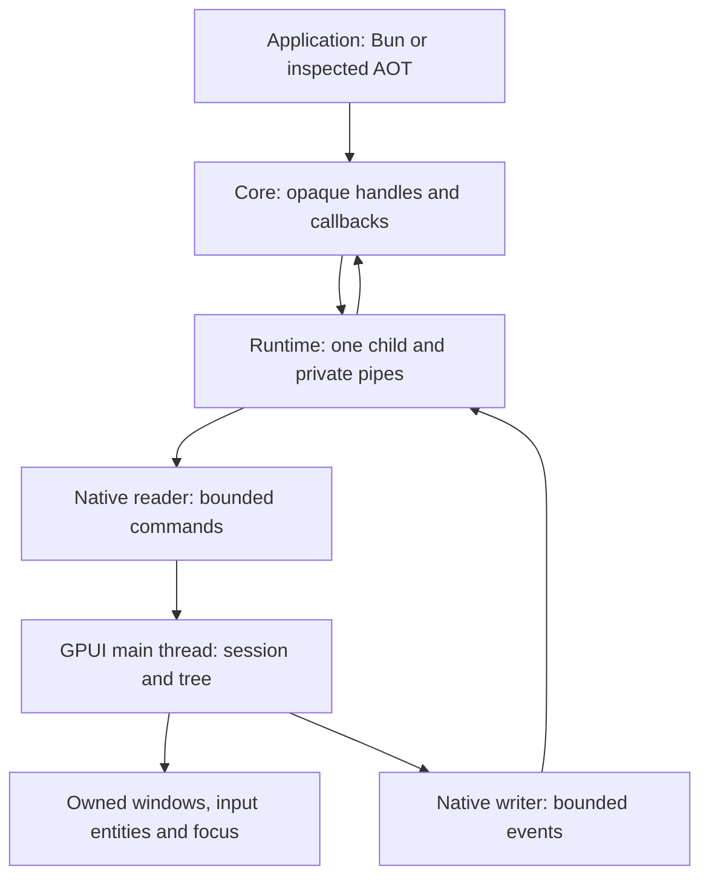

# Native host protocol 2

This is the implemented private Bun-to-GPUI contract for BN1. Application code
uses [`@bun-native/core`](../packages/core/README.md); Solid and React adapters
must target that same public API. They do not import this transport or construct
numeric handles. Protocol 1 was the BN0 integration fixture and is superseded
without a compatibility fallback.

The authoritative schemas and validators are
[`packages/protocol/src/messages.ts`](../packages/protocol/src/messages.ts),
[`elements.ts`](../packages/protocol/src/elements.ts), and
[`native/protocol/src/wire.rs`](../native/protocol/src/wire.rs). The
[Rust model](../native/protocol/src/tree.rs) independently validates mutations.
This document explains their ownership and ordering rules; it is not a second
schema implementation.

## Ownership and execution

The application owns one explicitly selected prebuilt host process. Launching
it never invokes Cargo or a shell. Its standard input/output carry the private
protocol; standard error carries bounded diagnostic capture. Rust I/O workers
perform blocking pipe operations, while the GPUI main thread alone changes
native windows, the model, focus and input entities. Native callbacks hold weak,
revocable state rather than owning an application's JavaScript closure.

The public core owns opaque node objects, window membership, a serialized
transaction queue and listener registrations. It continuously ingests native
events separately from executing application callbacks, so an awaiting listener
does not stop input-state observation or native-close revocation. Application
callbacks run in global event order, with at most one active callback. Each
registration has its own `AbortSignal`; replacement, unsubscribe, subtree
disposal and window/application close revoke that registration and discard its
queued callbacks. A callback that ignores cancellation loses authority over
disposed handles. The runtime cannot terminate arbitrary consumer JavaScript.

## Framing, negotiation and identity

- Each frame is one UTF-8 JSON object followed by a newline. The payload limit is
  65,536 bytes. Invalid UTF-8, oversize/truncated framing, malformed JSON, unknown
  fields or invalid message shapes fail the session rather than resynchronizing.
- The first request is `hello` with protocol `2`. The host emits `ready` with the
  same protocol, implemented capabilities and resource limits, then acknowledges
  the request. Both `tree` and `input_revisions` are mandatory. Missing features,
  version mismatch, duplicate readiness or acknowledgement before readiness
  fail launch and clean up the child.
- Request, window, root and node identities are positive JavaScript-safe
  integers. Committed window and node identities increase across the session;
  deletion does not make an identity reusable. Request identities also increase.
  Tree/input revisions begin at zero. UI event sequences begin at one and are
  contiguous across all windows in the session.
- The native model resolves each node within its owning window. A raw identity
  conveys no permission outside the session. The public core additionally checks
  object identity and owner membership; copying an opaque handle's visible
  properties cannot forge a usable handle.
- A failed native mutation does not consume its proposed window/node identity
  high-water mark or tree revision. The public allocator may leave gaps after a
  failed attempt; it never reuses handles already given to application code.

The two parsers deliberately agree on JavaScript-safe integral JSON numbers,
including `1.0` and `1e0`, and on last-value semantics for duplicate JSON keys.
Strings must be well-formed Unicode without NUL. This parity is covered by the
shared [negative corpus](../tests/fixtures/bridge-security.json) and parser tests.

## Commands and replies

Every command contains a request `id`. Replies must match that pending request's
type, owner and expected revision. A mismatched, unsolicited or duplicate reply
poisons the channel instead of satisfying another request.

| Command    | Required fields beyond `id` and `type`             | Successful reply                                                  |
| ---------- | -------------------------------------------------- | ----------------------------------------------------------------- |
| `hello`    | `protocol`                                         | `ready`, then `ack`                                               |
| `open`     | `window_id`, `root_id`, `title`, `width`, `height` | `opened` with matching window/root and tree revision 0            |
| `batch`    | `window_id`, `base_revision`, `operations`         | `applied` with matching window and tree revision incremented once |
| `close`    | `window_id`                                        | `ack` after native removal is requested                           |
| `shutdown` | none                                               | flushed final `ack`, then process exit                            |

The root is an existing `box` created by `open`. Closing the final window does
not automatically end the session; explicit GPUI quit mode permits later
windows. `closed` events describe native window closure and revoke the owning
public window. Public `close()` and `shutdown()` are idempotent even though raw
commands targeting a disposed window are invalid.

Each atomic `batch` supports the following operations:

| Operation | Meaning                                                                                                               |
| --------- | --------------------------------------------------------------------------------------------------------------------- |
| `create`  | Allocate a new `box`, `text`, `button` or `input` with complete validated properties.                                 |
| `set`     | Replace a node's properties with the same element kind; it is not a shallow property merge.                           |
| `insert`  | Attach or move a node under a `box`; the index is evaluated after detaching it from its old parent.                   |
| `delete`  | Remove a complete subtree and revoke its identities, input entities, focus and listeners. The root cannot be deleted. |

Validation runs against a candidate graph before native commit. It checks the
base revision, owner and element kind, root invariants, attachment, parent/child
consistency, ordering, cycles, depth and aggregate budgets. Every live node must
be attached when the batch finishes. A failure rolls back the entire batch.
An `applied` reply means native model/UI-thread acceptance, not GPU presentation.
Empty public batches stay local and do not increment the revision.

## Events and controlled input

`click` carries sequence, window and button identity. `input` additionally
carries the complete value and its independent `input_revision`. `closed`
carries sequence and window identity. The transport checks contiguous sequence;
the core checks the owner, kind and input revision before delivering callbacks.
Events already in flight for disposed nodes lose callback authority.

Native input edits increment the input revision without incrementing the tree
revision. An intentional application `set` of an input must include
`expected_input_revision` equal to the current native value's revision. A
successful replacement increments it; a stale replacement returns
`stale_revision` and changes nothing. A delayed unrelated tree transaction must
preserve newer input events observed while it was in flight. Ordinary typing
is observed without echoing older values back to the native editor.

## Bounds and backpressure

| Resource                                         |                                 Implemented maximum |
| ------------------------------------------------ | --------------------------------------------------: |
| Frame payload                                    |                                        65,536 bytes |
| Operations in one batch                          |                                                 256 |
| Live windows                                     |                                                  16 |
| Nodes per window, including root                 |                                               4,096 |
| Tree depth, measured in edges from root          |                                                  64 |
| Individual text/input string                     |                                  16,384 UTF-8 bytes |
| Aggregate model text per window                  |                               4,194,304 UTF-8 bytes |
| Window title                                     | 256 UTF-8 bytes; nonempty and no control characters |
| Native command queue                             |                                                  64 |
| Native output queue                              |                                                 256 |
| Runtime pending requests / unread UI events      |                                           128 / 128 |
| Public ordinary transactions / waiting callbacks |                                           128 / 128 |
| Concurrent application callbacks                 |                                                   1 |

The public transaction queue reserves additional cleanup capacity for one close
per live window. Reaching its ordinary-work limit rejects new work. Native
output uses nonblocking enqueue; an overflowing/disconnected output channel
terminates the failed session rather than blocking the UI thread. Event floods
also fail the bounded runtime/core queues. The reader may block on its bounded
command queue without blocking the GPUI thread. These limits bound selected
retained work, not total RSS, frame time or GPU allocation.

The runtime applies request/exit deadlines (default 5 seconds, configurable from
1 to 60,000 milliseconds), bounded output draining after process exit, ordered
writes and one event consumer. Failure rejects pending work, stops the child
and releases readers. Shutdown cannot wait forever for inherited pipes.

## Errors, trust and compatibility

Native errors are `invalid_command`, `version_mismatch`, `invalid_state`,
`invalid_handle`, `stale_revision`, `limit_exceeded` and `native_failure`.
A correlated recoverable command error becomes public `NativeCommandError`.
Malformed protocol, invalid sequence/reply or fatal transport failure ends the
session. Public preflight/ownership errors use `NativeStateError`, malformed
values use `ProtocolError`, and unsupported element kinds use
`UnsupportedFeatureError`. See the [public API ADR](decisions/0004-public-api.md)
for consumer handling and experimental compatibility policy.

The negotiated flags describe rendering features, not OS permission grants.
Protocol 2 has no file, shell, process, network, update or browser service
command. The [security ADR](decisions/0003-bridge-security.md) defines the trusted
application/untrusted data boundary and default-deny requirements for future
services. Neither AOT nor the child-process boundary sandboxes trusted Bun code.

## Verification scope

TypeScript and Rust schema/model tests, actual subprocess failure tests and
public lifecycle/type fixtures cover the contract's positive and negative
paths. Real Linux GPUI development and inspected AOT runs cover tree mutations,
pointer input, native typing, Enter activation, stale-input rejection, OS close
and teardown. See [bridge measurements](../benchmarks/BRIDGE.md) and
[testing](testing.md) for reproduction and evidence distinctions. A native
acknowledgement benchmark is not input-to-presentation latency.

Linux evidence currently uses X11/XTest and Mesa llvmpipe. macOS/Windows GUI,
Wayland, physical GPU/input, IME, accessibility, sanitizer instrumentation and
long-running leak qualification remain separate work. Headless cross-platform
protocol success cannot satisfy those native acceptance claims.
